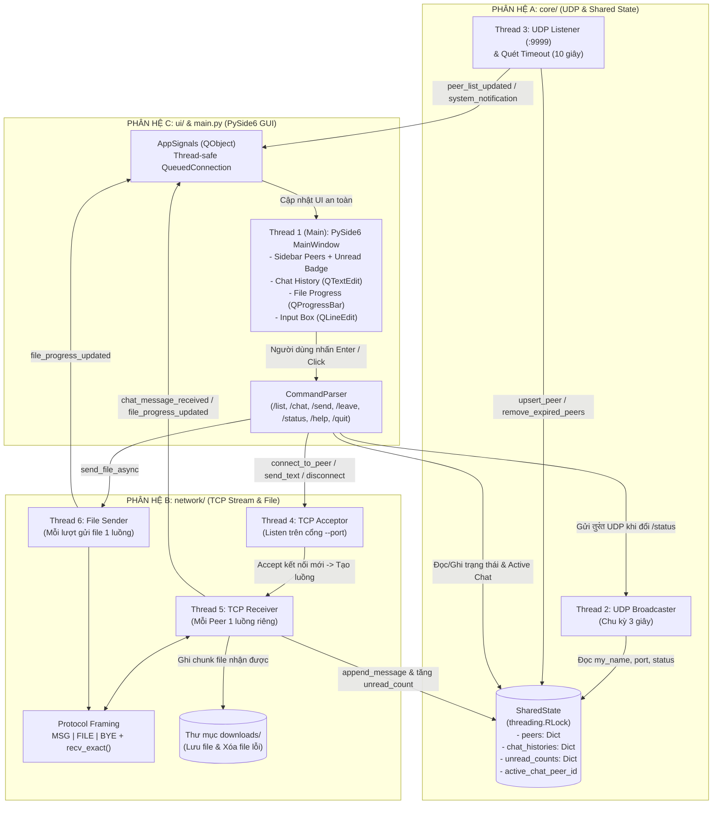
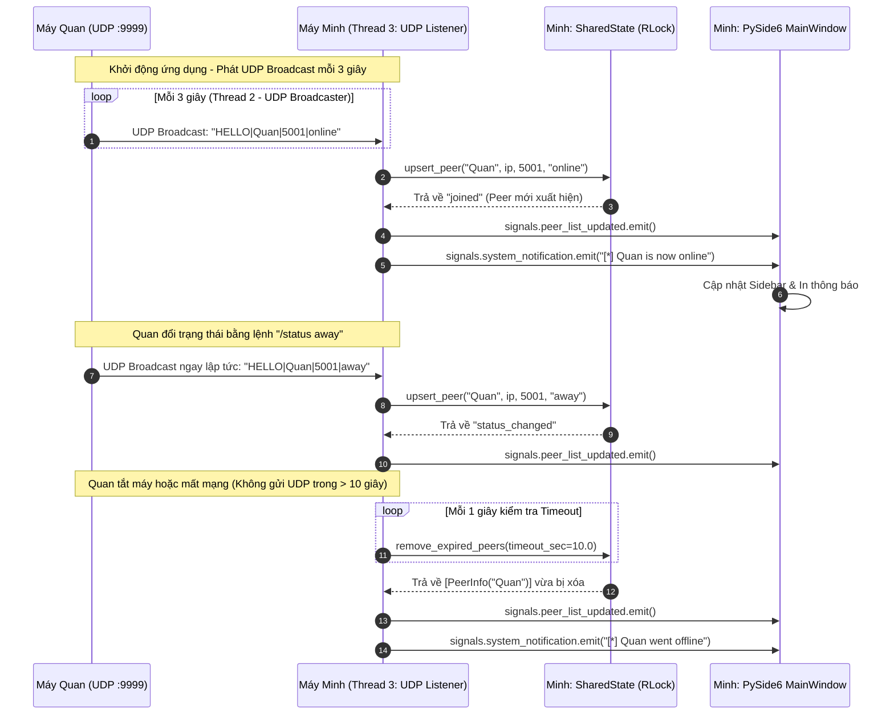
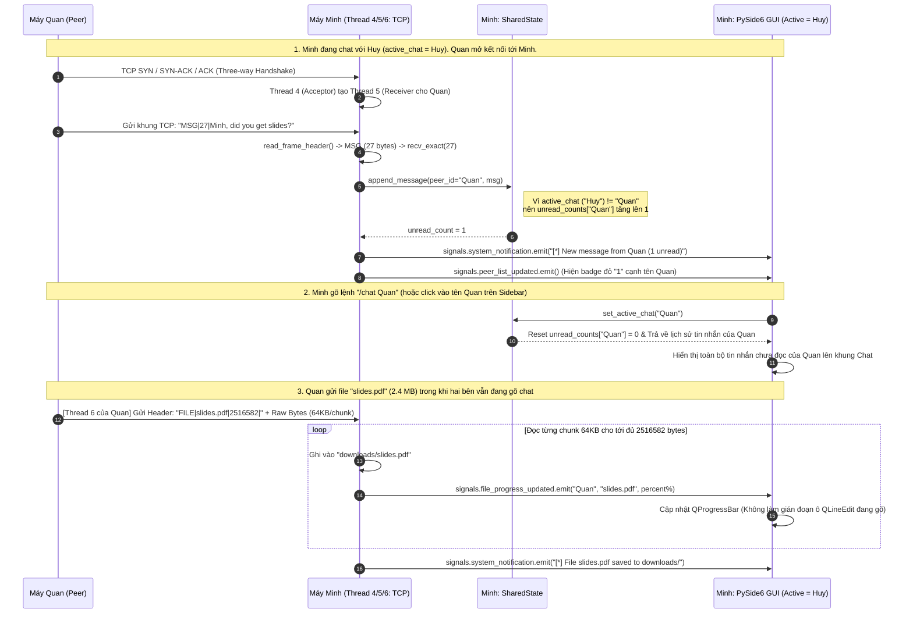
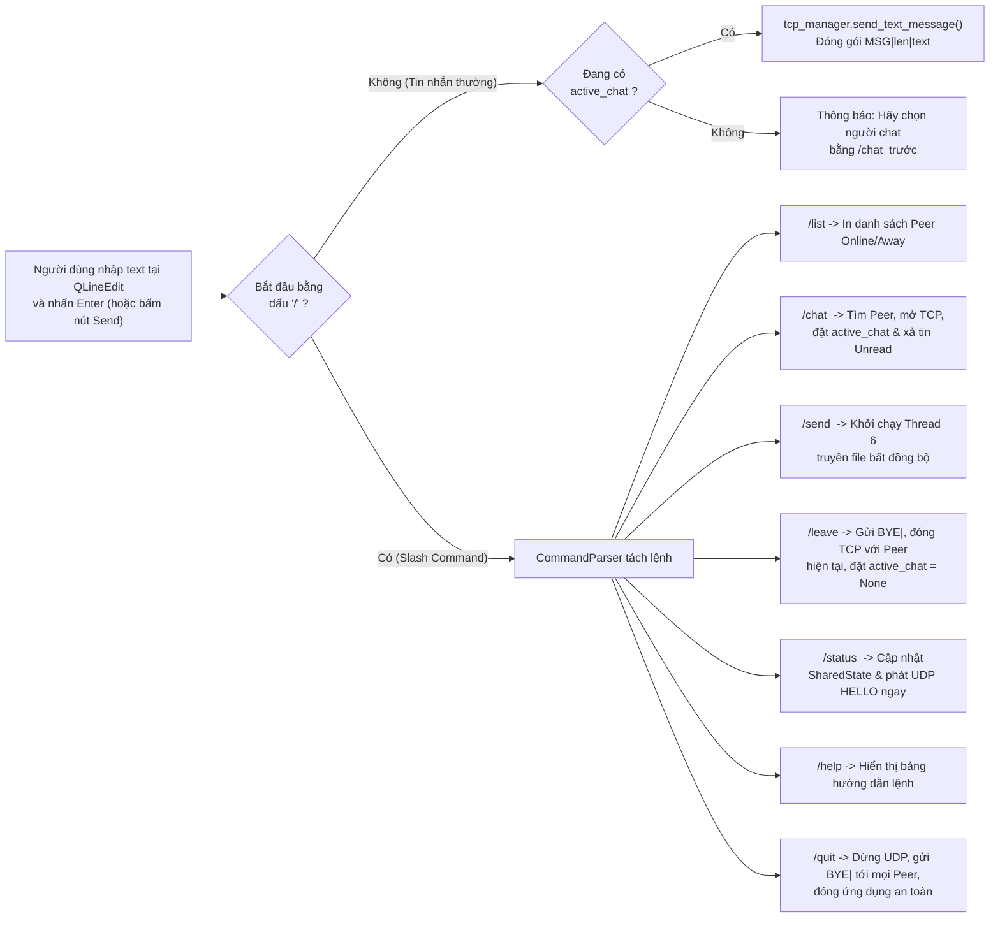
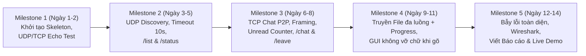

# KẾ HOẠCH TỔNG THỂ & KIẾN TRÚC HỆ THỐNG (ARCHITECTURE & IMPLEMENTATION OVERVIEW)
**Dự án:** LAN Chat & File Sharing (P2P TCP/UDP Sockets + PySide6 GUI)  
**Tài liệu gốc:** `plan.md`  
**Quy mô nhóm:** 3 Thành viên (Thành viên A, Thành viên B, Thành viên C)  
**Thời gian thực hiện:** 2 tuần (14 ngày – 5 Milestones)  
**Công nghệ sử dụng:** Python 3.x (`socket`, `threading` thuần) + `PySide6` (Qt for Python)

---

## 1. Tổng quan Dự án & Mục tiêu Kiến trúc

Ứng dụng **LAN Chat & File Sharing** là hệ thống giao tiếp ngang hàng (**Peer-to-Peer - P2P**), trong đó mỗi người dùng chạy cùng một chương trình vừa đóng vai trò **Client** vừa đóng vai trò **Server**. Dự án kết hợp cả hai giao thức tầng giao vận (Transport Layer):

1. **UDP (User Datagram Protocol - Cổng `9999`):**
   - Dùng cho việc tự động khám phá người dùng trong mạng LAN (**Peer Discovery**) và cập nhật trạng thái hiện diện (`online` / `away`).
   - Phát quảng bá (**UDP Broadcast**) định kỳ mỗi **3 giây** và tự động loại bỏ người dùng nếu không nhận được tín hiệu sau **10 giây** (timeout).
2. **TCP (Transmission Control Protocol - Cổng động theo tham số `--port`, mặc định `5000`):**
   - Dùng cho việc nhắn tin P2P (**Chat**) và truyền tập tin (**File Transfer**) nhằm đảm bảo tính tin cậy, đúng thứ tự và không mất mát dữ liệu.
   - Thiết kế giao thức đóng khung (**Application-Layer Framing**) rõ ràng trên dòng byte TCP: `MSG|<length>|<text>`, `FILE|<filename>|<size>|<bytes>`, `BYE|`.
3. **Đa luồng (6 Threads) & Giao diện PySide6 không vỡ chữ:**
   - Tuân thủ mô hình 6 luồng xử lý đồng thời, bảo vệ dữ liệu chung bằng `threading.RLock`.
   - Giao diện **PySide6** tách biệt hoàn toàn vùng hiển thị lịch sử chat (`QTextEdit`) và ô nhập liệu (`QLineEdit`), đồng thời giao tiếp giữa các luồng Socket và GUI thông qua cơ chế **Qt Signals & Slots (`QueuedConnection`)** để việc nhận tin nhắn/file không bao giờ làm gián đoạn hoặc đè chữ khi người dùng đang gõ.
   - Hỗ trợ **song song 2 phương thức điều khiển**: Thao tác chuột trên GUI và gõ lệnh trực tiếp (`/list`, `/chat`, `/send`, `/leave`, `/status`, `/help`, `/quit`).

---

## 2. Cấu trúc Thư mục Dự án (Repository & Skeleton Structure)

Cấu trúc dự án được chia thành 3 phân hệ độc lập tương ứng với 3 thành viên để hạn chế tối đa xung đột code (Merge Conflict) khi làm việc nhóm trên Git:

```text
lan-chat-socket/
├── .vscode/
│   └── launch.json              # Cấu hình chạy 3 Peers đồng thời trên 1 máy Windows (Quan, Minh, Huy)
├── downloads/                   # Thư mục lưu các file nhận được qua TCP
│   └── .gitkeep
├── core/                        # [PHÂN HỆ THÀNH VIÊN A] Quản lý trạng thái & UDP Discovery
│   ├── __init__.py
│   ├── models.py                # Định nghĩa Dataclass: PeerInfo, ChatMessage, FileTransferProgress
│   ├── shared_state.py          # Lớp SharedState bọc threading.RLock bảo vệ dữ liệu dùng chung
│   └── udp_discovery.py         # Thread 2 (UDP Broadcaster 3s) & Thread 3 (UDP Listener + Timeout 10s)
├── network/                     # [PHÂN HỆ THÀNH VIÊN B] Giao thức TCP Framing, Chat & File Transfer
│   ├── __init__.py
│   ├── protocol.py              # Đóng gói & bóc tách khung tin: HELLO|, MSG|, FILE|, BYE| & recv_exact()
│   ├── tcp_manager.py           # Thread 4 (TCP Acceptor) & Thread 5 (TCP Receiver cho mỗi peer)
│   └── file_transfer.py         # Thread 6 (File Sender chạy ngầm, báo % tiến độ, xóa file lỗi)
├── ui/                          # [PHÂN HỆ THÀNH VIÊN C] Giao diện PySide6 & Bộ phân tích lệnh
│   ├── __init__.py
│   ├── qt_signals.py            # Cầu nối Thread-safe (AppSignals) từ các luồng Socket lên GUI
│   ├── command_parser.py        # Xử lý các lệnh /list, /chat, /send, /leave, /status, /help, /quit
│   └── main_window.py           # Thread 1 (Main GUI): Cửa sổ PySide6 (Sidebar, Chat, Progress, Input)
├── tests/                       # Các kịch bản Mock Test độc lập cho từng thành viên A, B, C
│   ├── __init__.py
│   ├── mock_a_discovery.py      # Test UDP Discovery & Timeout trên Terminal
│   ├── mock_b_protocol.py       # Test TCP Framing & File Transfer độc lập
│   └── mock_c_ui.py             # Test giao diện PySide6 với dữ liệu giả lập
├── main.py                      # Điểm khởi chạy ứng dụng (--name, --port, --udp-port, --broadcast)
├── overview.md                  # Tài liệu kế hoạch tổng thể & kiến trúc luồng hoạt động (file này)
├── plan.md                      # Đề bài gốc của môn học
├── README.md                    # Hướng dẫn cài đặt, cấu hình Firewall và chạy ứng dụng
├── requirements.txt             # Khai báo thư viện (PySide6>=6.6.0)
└── .gitignore                   # Bỏ qua __pycache__, .venv, downloads/*
```

---

## 3. Sơ đồ Kiến trúc & Luồng hoạt động của Dự án

### 3.1. Sơ đồ Kiến trúc Tổng thể & Mô hình 6 Luồng (Architecture & Thread Model)

Sơ đồ dưới đây thể hiện mối quan hệ giữa **6 luồng (Threads)**, kho dữ liệu chung **`SharedState`** (được bảo vệ bởi `threading.RLock`), và cầu nối tín hiệu **`AppSignals`** lên giao diện PySide6:



---

### 3.2. Sơ đồ Tuần tự: Khám phá Người dùng & Tự động Xóa khi Timeout (UDP Discovery Flow)



---

### 3.3. Sơ đồ Tuần tự: Chat TCP, Bộ đếm Unread & Truyền File Song song (TCP Chat & File Flow)

Sơ đồ dưới đây minh họa kịch bản thực tế trong `plan.md`: **Minh đang chat với Huy**, trong lúc đó **Quan nhắn tin tới cho Minh** (hệ thống tăng bộ đếm `unread`), sau đó Minh chuyển sang chat với Quan và gửi file:



---

### 3.4. Sơ đồ Luồng xử lý Lệnh & Sự kiện Giao diện (Command & UI Flowchart)



---

## 4. Hợp đồng Dữ liệu & Chữ ký Hàm (Interface & Data Contract)

Để 3 thành viên làm việc song song mà không phụ thuộc lẫn nhau, các chữ ký hàm (Function Signatures) trong bộ khung Skeleton được cố định như sau:

### 4.1. Phân hệ của Thành viên A (`core/`)
- **`core/models.py`**:
  - `PeerInfo(name: str, ip: str, tcp_port: int, status: str = "online", last_seen: float)` — thuộc tính `peer_id -> "{ip}:{tcp_port}"`.
  - `ChatMessage(sender_name: str, sender_id: str, content: str, timestamp: float, is_system: bool = False)`.
  - `FileTransferProgress(peer_id: str, filename: str, transferred_bytes: int, total_bytes: int, direction: str)`.
- **`core/shared_state.py` (`SharedState`)**:
  - `set_my_status(status: str) -> None`
  - `get_my_info() -> Tuple[str, int, str]`
  - `upsert_peer(name: str, ip: str, tcp_port: int, status: str) -> Optional[str]`
  - `remove_expired_peers(timeout_sec: float = 10.0) -> List[PeerInfo]`
  - `get_online_peers() -> List[PeerInfo]`
  - `find_peer(target: str) -> Optional[PeerInfo]`
  - `set_active_chat(peer_id: Optional[str]) -> List[ChatMessage]`
  - `get_active_chat() -> Optional[PeerInfo]`
  - `append_message(peer_id: str, msg: ChatMessage) -> int`
  - `get_unread_count(peer_id: str) -> int`
- **`core/udp_discovery.py` (`UDPDiscoveryService`)**:
  - `start() -> None` / `stop() -> None`
  - `send_immediate_broadcast() -> None`

### 4.2. Phân hệ của Thành viên B (`network/`)
- **`network/protocol.py`**:
  - `encode_hello(name: str, tcp_port: int, status: str) -> bytes`
  - `decode_hello(data: bytes) -> Optional[Tuple[str, int, str]]`
  - `encode_msg(text: str) -> bytes`
  - `encode_file_header(filename: str, filesize: int) -> bytes`
  - `encode_bye() -> bytes`
  - `recv_exact(sock: socket.socket, num_bytes: int) -> bytes`
  - `read_frame_header(sock: socket.socket) -> Tuple[str, List[str]]`
- **`network/tcp_manager.py` (`TCPConnectionManager`)**:
  - `start_server() -> None`
  - `connect_to_peer(peer: PeerInfo) -> bool`
  - `send_text_message(peer_id: str, text: str) -> bool`
  - `send_file_async(peer_id: str, filepath: str) -> None`
  - `disconnect_peer(peer_id: str) -> None`
  - `stop_all() -> None`
- **`network/file_transfer.py` (`FileTransferService`)**:
  - `start_send_file_thread(peer_id: str, filepath: str, sock: socket.socket, send_lock: threading.Lock) -> None`
  - `receive_file_stream(conn: socket.socket, peer_id: str, filename: str, filesize: int) -> None`

### 4.3. Phân hệ của Thành viên C (`ui/` & `main.py`)
- **`ui/qt_signals.py` (`AppSignals(QObject)`)**:
  - `peer_list_updated = Signal()`
  - `system_notification = Signal(str)`
  - `chat_message_received = Signal(str, object)`
  - `file_progress_updated = Signal(str, str, int)`
  - `peer_disconnected = Signal(str, str)`
- **`ui/command_parser.py` (`CommandParser`)**:
  - `handle_user_input(raw_text: str) -> None`
- **`ui/main_window.py` (`MainWindow(QMainWindow)`)**:
  - Các `@Slot` nhận sự kiện từ `AppSignals` và cập nhật lên `QListWidget`, `QTextEdit`, `QProgressBar`.

---

## 5. Phân chia Nhiệm vụ Chi tiết cho 3 Thành viên

| Thành viên | Mảng phụ trách | Chi tiết công việc cần hoàn thành |
| :--- | :--- | :--- |
| **Thành viên A** | **UDP Discovery & Shared State**<br>(`core/`) | 1. Hoàn thiện các phương thức trong `SharedState` với `threading.RLock`.<br>2. Viết `UDPDiscoveryService`: cấu hình `SO_BROADCAST`, `SO_REUSEADDR`, phát `HELLO\|<name>\|<tcp_port>\|<status>` mỗi 3 giây.<br>3. Lắng nghe cổng UDP `9999`, lọc bỏ gói tin của chính mình, thêm/cập nhật peer và quét xóa peer không phản hồi sau 10 giây.<br>4. Viết kịch bản tự kiểm thử trong `tests/mock_a_discovery.py`. |
| **Thành viên B** | **TCP Core, Framing & File Transfer**<br>(`network/`) | 1. Hoàn thiện bộ đóng/mở khung giao thức trong `network/protocol.py` (đặc biệt là `recv_exact` và `read_frame_header` xử lý tiếng Việt UTF-8 nhiều byte).<br>2. Viết `TCPConnectionManager`: quản lý Thread 4 (Acceptor) và Thread 5 (Receiver cho từng peer), dùng khóa gửi `_send_locks` tránh xung đột ghi socket.<br>3. Viết `FileTransferService`: truyền file theo chunk 64KB ở Thread 6, báo `%` tiến độ, lưu file vào `downloads/`, và **xóa file dở dang (`os.remove`)** nếu đứt kết nối giữa chừng.<br>4. Viết kịch bản tự kiểm thử trong `tests/mock_b_protocol.py`. |
| **Thành viên C** | **PySide6 GUI, Command Parser & Tích hợp**<br>(`ui/`, `main.py`) | 1. Hoàn thiện giao diện PySide6 trong `ui/main_window.py`: danh sách peer có chấm màu trạng thái (`online`/`away`) và số lượng `unread`, khung lịch sử chat, thanh `QProgressBar`, hộp thoại chọn file `QFileDialog`.<br>2. Hoàn thiện `CommandParser` hỗ trợ đầy đủ 7 lệnh (`/list`, `/chat`, `/send`, `/leave`, `/status`, `/help`, `/quit`) và kết nối sự kiện click chuột trên GUI.<br>3. Phụ trách ghép nối tổng thể tại `main.py`, chụp ảnh gói tin Wireshark và chuẩn bị kịch bản Demo. |

---

## 6. Lộ trình Triển khai 2 Tuần (14 Ngày) theo 5 Milestones



| Tuần | Ngày | Milestone | Mục tiêu & Tiêu chí Nghiệm thu (Checkpoint) |
| :---: | :---: | :--- | :--- |
| **Tuần 1** | **Ngày 1 – 2** | **Milestone 1** | - Khởi tạo xong Git repository và bộ khung Skeleton.<br>- Chạy thử thành công giao diện cơ bản PySide6 và các bài test socket đơn giản. |
| **Tuần 1** | **Ngày 3 – 5** | **Milestone 2** | - Hoàn thành `core/shared_state.py` và `core/udp_discovery.py`.<br>- Kết nối danh sách Peer lên Sidebar của PySide6; chạy được lệnh `/list` và `/status <online\|away>`.<br>- **Checkpoint:** Mở 3 cửa sổ trên 1 máy (hoặc 2 máy LAN), thấy nhau tự động sau <3s, tắt 1 cửa sổ thì sau 10s tự biến mất khỏi danh sách. |
| **Tuần 1 – 2** | **Ngày 6 – 8** | **Milestone 3** | - Hoàn thành `network/protocol.py` và `network/tcp_manager.py` cho gói `MSG\|` và `BYE\|`.<br>- Hoàn thành lệnh `/chat <name\|number>`, `/leave` và cơ chế lưu tin nhắn chưa đọc (`unread_counts`).<br>- **Checkpoint:** Hai người chat 2 chiều mượt mà; người thứ 3 nhắn tới sẽ hiện thông báo `[*] New message from ... (1 unread)` và hiển thị đầy đủ khi chuyển sang chat với người đó. |
| **Tuần 2** | **Ngày 9 – 11** | **Milestone 4** | - Hoàn thành `network/file_transfer.py` (Thread 6) và thanh `QProgressBar` trên PySide6.<br>- **Checkpoint:** Vừa truyền một file lớn (20MB–100MB) qua `/send` vừa tiếp tục gõ và nhận tin nhắn chat bình thường, chữ đang gõ trong ô input không bị ảnh hưởng. |
| **Tuần 2** | **Ngày 12 – 14** | **Milestone 5** | - Kiểm thử toàn bộ kịch bản lỗi: tắt ngang ứng dụng khi đang chat/đang gửi file (tự xóa partial file trong `downloads/`), kết nối tới peer đã offline, nhập sai lệnh.<br>- Chụp ảnh màn hình **Wireshark** (gói UDP port 9999 & TCP 3-way handshake), hoàn thiện báo cáo 5–10 trang và chuẩn bị Live Demo 10 phút. |

---

## 7. Quy chuẩn Git & Hướng dẫn Kiểm thử trên Windows

1. **Quy tắc phân nhánh Git:**
   - Nhánh chính: `main` (chỉ merge khi hoàn tất từng Milestone) và `develop` (nhánh ghép code của 3 thành viên).
   - Nhánh cá nhân: `feat/a-udp-discovery`, `feat/b-tcp-framing`, `feat/c-pyside6-ui`.
2. **Chạy thử 3 người dùng trên cùng 1 máy Windows:**
   - Mở VS Code, vào tab **Run and Debug (`Ctrl+Shift+D`)**, chọn cấu hình **`Launch 3 Peers on 1 PC (Quan, Minh, Huy)`** và nhấn `F5`.
   - Hoặc chạy trên 3 cửa sổ PowerShell:
     ```powershell
     python main.py --name Quan --port 5001 --broadcast 127.255.255.255
     python main.py --name Minh --port 5002 --broadcast 127.255.255.255
     python main.py --name Huy  --port 5003 --broadcast 127.255.255.255
     ```
3. **Bắt gói tin bằng Wireshark phục vụ Báo cáo:**
   - Khi test trên cùng 1 máy: Chọn card mạng **Adapter for loopback traffic capture** trong Wireshark.
   - Khi test giữa 2 máy qua Wi-Fi/LAN: Chọn card mạng **Wi-Fi / Ethernet**.
   - Bộ lọc hiển thị (Display Filter) trên Wireshark:
     - Xem gói tin UDP Discovery: `udp.port == 9999`
     - Xem bắt tay 3 bước TCP & truyền tin/file: `tcp.port in {5000..5010}`
