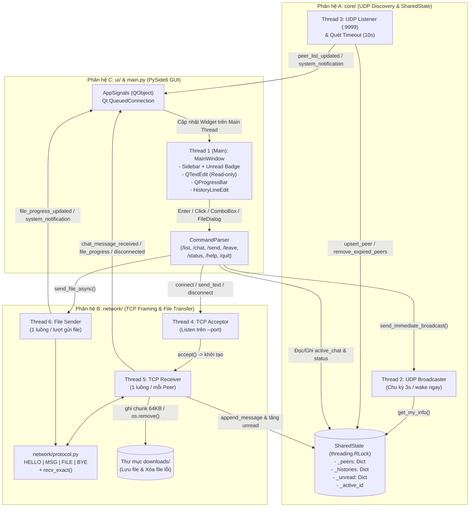
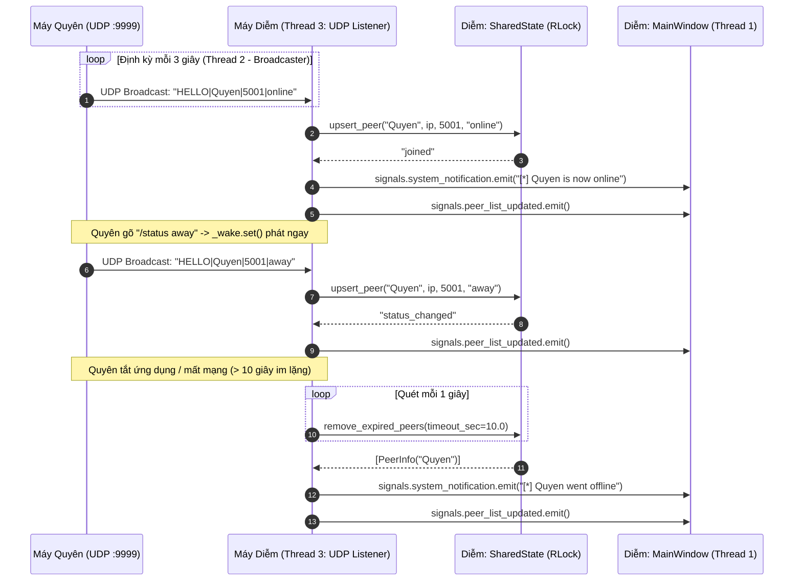
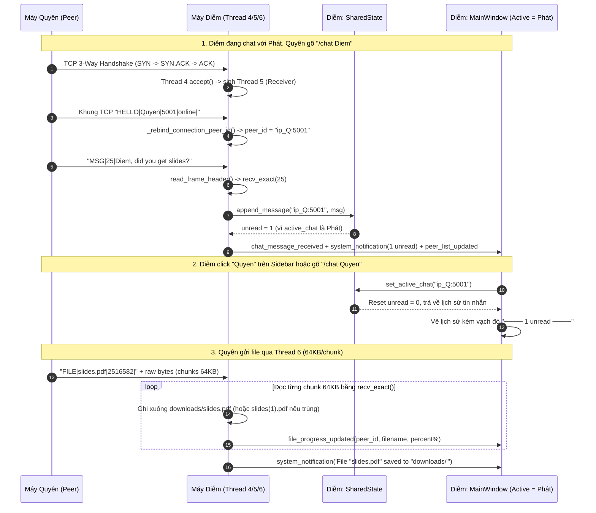
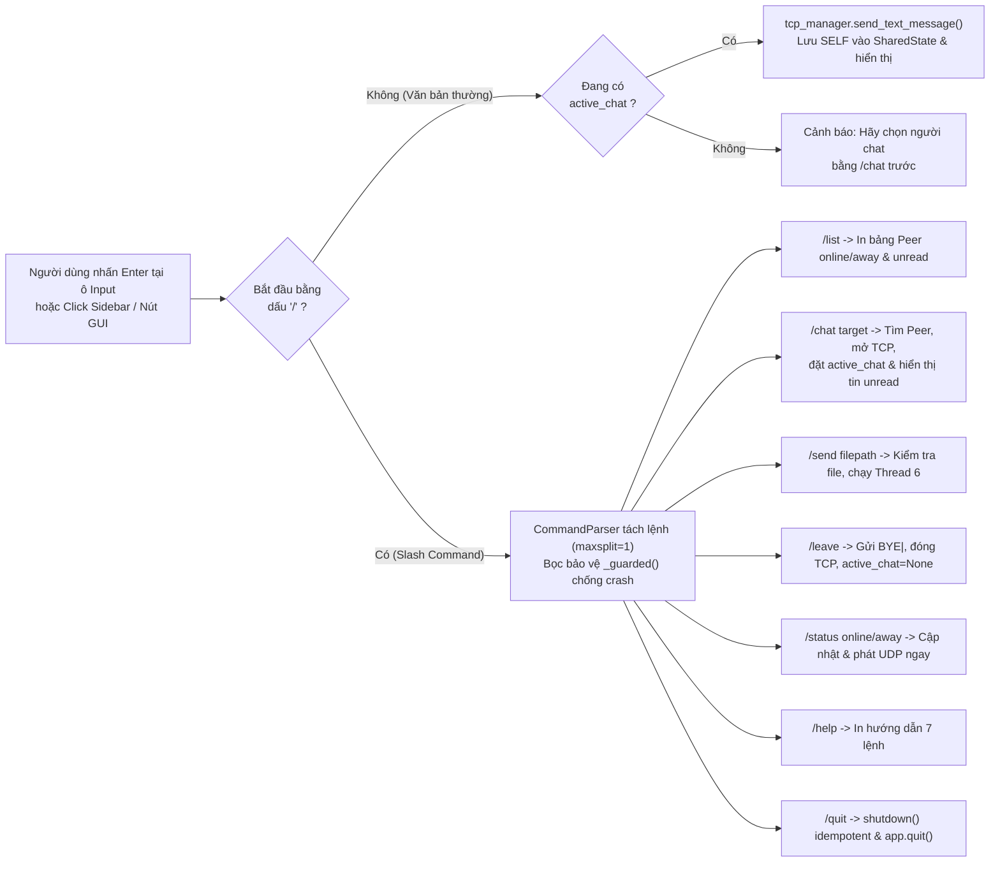

# BÁO CÁO ĐỒ ÁN MÔN HỌC
## ỨNG DỤNG LAN CHAT & FILE SHARING P2P SỬ DỤNG TCP/UDP SOCKETS VÀ GIAO DIỆN PYSIDE6

---

### THÔNG TIN CHUNG

| Mục | Nội dung |
| :--- | :--- |
| **Trường / Khoa** | `[Tên Trường – Tên Khoa]` |
| **Môn học** | `[Tên Môn học – VD: Lập trình Mạng / Mạng Máy tính]` |
| **Lớp / Học kỳ** | `[Mã Lớp – Học kỳ / Năm học]` |
| **Giảng viên hướng dẫn** | `[Họ tên Giảng viên]` |
| **Tên đề tài** | LAN Chat & File Sharing (Peer-to-Peer TCP/UDP Sockets + PySide6 GUI) |
| **Ngôn ngữ & Công nghệ** | Python 3 (`socket`, `threading` thuần) + PySide6 (Qt for Python) |
| **Môi trường kiểm thử** | Windows, Python `3.15.2` (`.venv`), PySide6 `6.12.0` |
| **Ngày hoàn thành** | 27/11/2026 |

### DANH SÁCH THÀNH VIÊN & PHÂN CÔNG CÔNG VIỆC

| Thành viên | Họ và tên | MSSV | Phân hệ & Tệp phụ trách | Nhiệm vụ chính |
| :---: | :--- | :---: | :--- | :--- |
| **Thành viên A** | **Ngọc Diễm** | `[MSSV]` | `core/models.py`<br>`core/shared_state.py`<br>`core/udp_discovery.py`<br>`tests/mock_a_discovery.py` | Thiết kế cấu trúc dữ liệu dùng chung, kho trạng thái an toàn luồng (`SharedState` + `RLock`), dịch vụ UDP Discovery (Thread 2 & Thread 3, chu kỳ 3s, timeout 10s) và kiểm thử độc lập phân hệ A. |
| **Thành viên B** | **Văn Thành Phát** | `[MSSV]` | `network/protocol.py`<br>`network/tcp_manager.py`<br>`network/file_transfer.py`<br>`tests/mock_b_protocol.py` | Thiết kế giao thức đóng khung tầng ứng dụng (`HELLO\|`, `MSG\|`, `FILE\|`, `BYE\|`, `recv_exact`), quản lý kết nối TCP đa luồng (Thread 4 & Thread 5), truyền nhận file bất đồng bộ (Thread 6), xóa partial file và kiểm thử độc lập phân hệ B. |
| **Thành viên C** | **Ngọc Quyên** | `[MSSV]` | `ui/qt_signals.py`<br>`ui/command_parser.py`<br>`ui/main_window.py`<br>`main.py`<br>`tests/mock_c_ui.py`<br>`docs/demo_script.md` | Xây dựng cầu nối tín hiệu `AppSignals`, bộ phân tích 7 lệnh `CommandParser`, giao diện PySide6 (`MainWindow`, Thread 1) không vỡ chữ, tích hợp tổng thể tại `main.py`, kịch bản Demo/Wireshark và kiểm thử độc lập phân hệ C. |

---

## MỤC LỤC

1. [Chương 1. Tổng quan Dự án & Phân tích Yêu cầu](#chương-1-tổng-quan-dự-án--phân-tích-yêu-cầu)
2. [Chương 2. Kiến trúc Hệ thống & Mô hình Đa luồng](#chương-2-kiến-trúc-hệ-thống--mô-hình-đa-luồng)
3. [Chương 3. Thiết kế Giao thức Tầng Ứng dụng & Cơ chế Đóng khung](#chương-3-thiết-kế-giao-thức-tầng-ứng-dụng--cơ-chế-đóng-khung)
4. [Chương 4. Thiết kế Giao diện PySide6 & Bộ Phân tích Lệnh](#chương-4-thiết-kế-giao-diện-pyside6--bộ-phân-tích-lệnh)
5. [Chương 5. Phân tích Gói tin Thực tế bằng Wireshark](#chương-5-phân-tích-gói-tin-thực-tế-bằng-wireshark)
6. [Chương 6. Các Khó khăn Gặp phải & Giải pháp Khắc phục](#chương-6-các-khó-khăn-gặp-phải--giải-pháp-khắc-phục)
7. [Chương 7. Kết quả Kiểm thử & Đánh giá](#chương-7-kết-quả-kiểm-thử--đánh-giá)
8. [Chương 8. Phân tích Đánh đổi Kỹ thuật, Hạn chế & Hướng Phát triển](#chương-8-phân-tích-đánh-đổi-kỹ-thuật-hạn-chế--hướng-phát-triển)
9. [Chương 9. Kết luận](#chương-9-kết-luận)
10. [Tài liệu Tham khảo](#tài-liệu-tham-khảo)

### DANH MỤC BẢNG BIỂU & HÌNH ẢNH

**Danh mục Bảng:**
- **Bảng 1.1:** Đối chiếu yêu cầu chức năng và tiêu chí đánh giá (`docs/plan.md`) với mức độ hoàn thành.
- **Bảng 2.1:** Bảng phân rã mô hình 6 luồng xử lý đồng thời (Thread Model).
- **Bảng 3.1:** Đặc tả các khung tin tầng ứng dụng (UDP & TCP Framing).
- **Bảng 4.1:** Danh sách 7 lệnh Slash Command và thao tác GUI tương ứng.
- **Bảng 7.1:** Tổng hợp kết quả kiểm thử tự động (Automated Self-Tests) của 3 phân hệ.
- **Bảng 7.2:** Kết quả kiểm thử tích hợp end-to-end (3 peer trên 1 máy & 2 máy LAN/Wi-Fi).

**Danh mục Hình ảnh & Sơ đồ:**
- **Sơ đồ 2.1:** Kiến trúc tổng thể hệ thống và mô hình 6 luồng (Mermaid Flowchart).
- **Sơ đồ 3.1:** Luồng khám phá người dùng, đổi trạng thái và timeout 10 giây qua UDP (Mermaid Sequence Diagram).
- **Sơ đồ 3.2:** Luồng chat TCP đa peer, bộ đếm `unread` và truyền file song song (Mermaid Sequence Diagram).
- **Sơ đồ 4.1:** Luồng xử lý nhập liệu, lệnh slash command và đồng bộ GUI (Mermaid Flowchart).
- **Hình 4.1:** Giao diện chính `MainWindow` của ứng dụng LAN Chat & File Sharing trên PySide6.
- **Hình 5.1:** Ảnh chụp Wireshark – Gói tin UDP Discovery Broadcast (`HELLO|...`) trên cổng `9999`.
- **Hình 5.2:** Ảnh chụp Wireshark – Quá trình bắt tay 3 bước TCP (`SYN`, `SYN-ACK`, `ACK`).
- **Hình 5.3:** Ảnh chụp Wireshark – Khung đóng gói tin nhắn tiếng Việt UTF-8 (`MSG|<byte_length>|<text>`).
- **Hình 5.4:** Ảnh chụp Wireshark – Quá trình truyền file (`FILE|...`) và đóng kết nối lịch sự (`BYE|` + `FIN, ACK`).

---

## Chương 1. Tổng quan Dự án & Phân tích Yêu cầu

### 1.1. Bối cảnh và Mục tiêu Đề tài

Trong mạng cục bộ (LAN / Wi-Fi), nhu cầu trao đổi tin nhắn nhanh và chia sẻ tập tin trực tiếp giữa các máy tính mà không phụ thuộc vào máy chủ trung tâm (Central Server) hay kết nối Internet là một bài toán điển hình của lập trình mạng. Đồ án **LAN Chat & File Sharing** được xây dựng theo kiến trúc **ngang hàng (Peer-to-Peer – P2P)**: mọi nút mạng đều chạy cùng một chương trình, đồng thời đóng vai trò **Client** (chủ động phát quảng bá và mở kết nối đi) lẫn **Server** (lắng nghe quảng bá UDP và chấp nhận kết nối TCP đến).

Điểm cốt lõi của đề bài là khai thác **đồng thời cả hai giao thức tầng giao vận** bằng API socket gốc của ngôn ngữ lập trình (`socket` trong thư viện chuẩn Python), phát huy đúng ưu thế của từng giao thức:

- **UDP (User Datagram Protocol – cổng mặc định `9999`):** Nhẹ, không cần thiết lập kết nối, hỗ trợ quảng bá (**UDP Broadcast**). Rất phù hợp cho cơ chế tự động khám phá người dùng (**Peer Discovery**) và đồng bộ trạng thái (`online` / `away`) định kỳ mỗi 3 giây. Nếu mất một gói datagram đơn lẻ, gói kế tiếp sẽ tự động bổ sung mà không ảnh hưởng tới hệ thống.
- **TCP (Transmission Control Protocol – cổng lắng nghe cấu hình qua `--port`, mặc định `5000`):** Hướng kết nối, đảm bảo truyền tin cậy, đúng thứ tự, không mất mát dữ liệu nhờ cơ chế xác nhận (ACK) và truyền lại. Phù hợp tuyệt đối cho **nhắn tin chat P2P** và **truyền tập tin nhị phân** (File Transfer), nơi mọi byte dữ liệu đều phải nguyên vẹn.

### 1.2. Đối chiếu Yêu cầu Đề bài & Tiêu chí Đánh giá

| STT | Tiêu chí theo `docs/plan.md` | Trọng số | Hiện thực trong dự án | Trạng thái |
| :---: | :--- | :---: | :--- | :---: |
| 1 | **UDP Discovery, danh sách online & trạng thái** (`3s` broadcast, `10s` timeout, `online`/`away`, thông báo vào/ra) | 15% | `core/udp_discovery.py` (`UDPDiscoveryService` – Thread 2 & 3) + `core/shared_state.py`; hỗ trợ phát ngay khi đổi trạng thái (`send_immediate_broadcast`). | Hoàn thành |
| 2 | **TCP Chat 2 chiều, nhiều peer & bộ đếm `unread`** | 20% | `network/tcp_manager.py` (Thread 4 & 5); giữ kết nối đồng thời nhiều peer, lưu lịch sử riêng theo `peer_id`, đếm `unread` và thông báo tức thời. | Hoàn thành |
| 3 | **Truyền file qua TCP có tiến độ (`%`), lưu `downloads/`, chạy luồng riêng** | 15% | `network/file_transfer.py` (Thread 6, chunk 64 KB), `QProgressBar`, tự đổi tên `(1)`, `(2)` tránh ghi đè, chat/UI vẫn mượt trong lúc truyền. | Hoàn thành |
| 4 | **Giao diện không vỡ chữ khi tin nhắn đến lúc đang gõ** (Console hoặc GUI) | 15% | `ui/main_window.py` (PySide6): tách biệt `QTextEdit` (read-only) và `HistoryLineEdit` (`QLineEdit`), cầu nối `AppSignals` (`QueuedConnection`), hỗ trợ đủ 7 lệnh + thao tác chuột. | Hoàn thành |
| 5 | **Thiết kế giao thức & đóng khung (Protocol & Framing)** | 10% | `network/protocol.py`: `HELLO\|`, `MSG\|<len>\|<utf-8>`, `FILE\|<name>\|<size>\|<bytes>`, `BYE\|`; độ dài theo byte UTF-8, `recv_exact()` chống dính/cắt gói. | Hoàn thành |
| 6 | **Xử lý lỗi & Độ ổn định (Error Handling)** | 10% | Xóa partial file (`os.remove`), phát hiện peer đóng ngang / offline, bắt lỗi trùng cổng (`WinError 10048`), xác thực tham số CLI, kiểm tra lệnh/file không hợp lệ, dọn socket idempotent. | Hoàn thành |
| 7 | **Báo cáo kỹ thuật (5–10 trang) & Ảnh Wireshark** | 10% | `report.md` (tài liệu này) kèm phân tích kiến trúc, 6 luồng, framing, khó khăn/giải pháp, kết quả kiểm thử và khung phân tích 4 ảnh Wireshark. | Hoàn thành |
| 8 | **Live Demo (10 phút trên 2+ máy) & Chất lượng mã nguồn** | 5% | Kiến trúc tách 3 module rõ ràng, `README.md`, `instruction.md`, `docs/demo_script.md`, cấu hình VS Code `.vscode/launch.json` và 3 bộ test tự động. | Hoàn thành |

*Bảng 1.1: Đối chiếu yêu cầu chức năng và tiêu chí đánh giá (`docs/plan.md`) với mức độ hoàn thành.*

### 1.3. Quy trình Cộng tác & Hợp đồng Giao diện (Interface Contract)

Để 3 thành viên phát triển song song trong 2 tuần mà không phát sinh xung đột mã nguồn (Merge Conflict), nhóm đã thống nhất trước bộ khung giao diện hàm (**Interface Contract**) trong `docs/overview.md` và tách biệt ranh giới thư mục (`core/`, `network/`, `ui/`). Mỗi thành viên làm việc trên nhánh Git riêng (`feat/a-udp-discovery`, `feat/b-tcp-framing`, `feat/c-pyside6-ui`), kiểm chứng độc lập bằng script mock (`tests/mock_a_discovery.py`, `tests/mock_b_protocol.py`, `tests/mock_c_ui.py`), sau đó hợp nhất về nhánh `main` và thực hiện kiểm thử tích hợp end-to-end.

---

## Chương 2. Kiến trúc Hệ thống & Mô hình Đa luồng

### 2.1. Cấu trúc Thư mục Mã nguồn

```text
Socket_LanChatFileSharing/
├── .vscode/launch.json          # Cấu hình chạy nhanh 3 peer trên 1 máy Windows (Quyen, Diem, Phat)
├── core/                        # [Thành viên A] Trạng thái dùng chung & UDP Discovery
│   ├── models.py                # Dataclass: PeerInfo, ChatMessage, FileTransferProgress
│   ├── shared_state.py          # SharedState bảo vệ bằng threading.RLock
│   └── udp_discovery.py         # Thread 2 (UDP Broadcaster 3s) & Thread 3 (UDP Listener + Timeout 10s)
├── network/                     # [Thành viên B] Giao thức TCP Framing, Chat & File Transfer
│   ├── protocol.py              # Đóng/mở khung HELLO|, MSG|, FILE|, BYE| & recv_exact()
│   ├── tcp_manager.py           # Thread 4 (TCP Acceptor) & Thread 5 (TCP Receiver / peer)
│   └── file_transfer.py         # Thread 6 (File Sender), lưu downloads/ & xóa partial file lỗi
├── ui/                          # [Thành viên C] Giao diện PySide6 & Command Parser
│   ├── qt_signals.py            # Cầu nối tín hiệu đa luồng an toàn AppSignals (QObject)
│   ├── command_parser.py        # Bộ phân tích 7 lệnh (/list, /chat, /send, /leave, /status, /help, /quit)
│   └── main_window.py           # Thread 1 (Main GUI): MainWindow, HistoryLineEdit, PeerItemWidget
├── tests/                       # 3 kịch bản kiểm thử tự động & tương tác độc lập (A, B, C)
├── docs/                        # Đề bài (plan.md), kiến trúc (overview.md), kịch bản Demo (demo_script.md)
├── downloads/                   # Thư mục lưu tập tin nhận được qua TCP
├── main.py                      # Điểm khởi chạy, xác thực CLI, ghép nối A + B + C và bắt SIGINT
├── instruction.md               # Hướng dẫn chạy 2 máy LAN/Wi-Fi, 1 máy & 8 kịch bản test chi tiết
├── README.md                    # Hướng dẫn cài đặt môi trường & khởi chạy nhanh
└── requirements.txt             # PySide6>=6.6.0
```

### 2.2. Sơ đồ Kiến trúc Tổng thể & Mô hình 6 Luồng

Hệ thống tuân thủ chặt chẽ mô hình 6 luồng do đề bài đề xuất. Toàn bộ các luồng nền (Thread 2–6) tuyệt đối **không import Qt** ở tầng `core/` và `network/`; thay vào đó, chúng nhận một đối tượng `signals` theo kiểu duck-typing (`AppSignals`) để phát sự kiện bất đồng bộ về Main GUI Thread.


*Sơ đồ 2.1: Kiến trúc tổng thể 3 phân hệ và tương tác giữa 6 luồng xử lý.*

### 2.3. Chi tiết Trách nhiệm 6 Luồng (Thread Model)

| Luồng | Tên trong mã nguồn | Chờ sự kiện gì? | Trách nhiệm chính | Daemon |
| :--- | :--- | :--- | :--- | :---: |
| **Thread 1 (Main)** | Main Thread (`QApplication`) | Vòng lặp sự kiện GUI (bàn phím, chuột, `AppSignals`) | Vẽ `MainWindow`, đọc ô nhập liệu, chạy `CommandParser`, cập nhật lịch sử chat, badge `unread` và `QProgressBar`. | Không |
| **Thread 2** | `udp-broadcaster` | `threading.Event.wait(3.0)` | Phát gói UDP `HELLO\|<name>\|<port>\|<status>` định kỳ mỗi 3 giây, hoặc phát tức thời khi `_wake.set()` được gọi từ `/status`. | Có |
| **Thread 3** | `udp-listener` | `socket.recvfrom(1024)` (timeout `0.5s`) | Nhận gói UDP trên cổng `9999`, lọc gói của chính mình, `upsert_peer()` vào `SharedState`; mỗi `1.0s` quét `remove_expired_peers(10.0)`. | Có |
| **Thread 4** | `TCPAcceptor-<port>` | `server_sock.accept()` | Lắng nghe kết nối TCP đến trên cổng `--port` (backlog `16`), đăng ký socket vào bảng `_connections` và sinh 1 Thread 5 tương ứng. | Có |
| **Thread 5** | `TCPReceiver-<peer_id>` *(1 luồng / peer)* | `read_frame_header(conn)` & `recv_exact()` | Đọc tuần tự các khung `HELLO\|`, `MSG\|`, `FILE\|`, `BYE\|` của từng peer; lưu tin nhắn, đếm `unread`, nhận luồng file vào `downloads/` và dọn socket khi ngắt. | Có |
| **Thread 6** | `FileSender-<peer_id>` *(1 luồng / file)* | Đọc đĩa theo chunk `64 KB` & `sock.sendall()` | Truyền header `FILE\|` cùng dữ liệu nhị phân bất đồng bộ không làm đơ giao diện; phát tín hiệu tiến độ `%` lên `QProgressBar`. | Có |

*Bảng 2.1: Phân rã trách nhiệm mô hình 6 luồng xử lý đồng thời (Thread Model).*

### 2.4. Cơ chế Đồng bộ hóa Dữ liệu & An toàn Đa luồng (Thread Safety)

Vì 6 luồng đồng thời truy cập danh sách người dùng, lịch sử tin nhắn, socket TCP và giao diện đồ họa, dự án áp dụng **3 tầng bảo vệ đồng thời**:

1. **Bảo vệ trạng thái chung bằng `threading.RLock` & bản sao dữ liệu (`core/shared_state.py`):**
   `SharedState` dùng khóa tái nhập `RLock` (cho phép một phương thức như `get_active_chat()` gọi lồng `get_peer()` trong cùng luồng mà không bị deadlock). Quan trọng hơn, các hàm đọc luôn trả về **bản sao mới** bằng `dataclasses.replace(p)` hoặc `list(...)` để các luồng bên ngoài đọc an toàn mà không giữ khóa lâu:

   ```python
   # core/shared_state.py
   def get_online_peers(self) -> List[PeerInfo]:
       with self._lock:
           return [dataclasses.replace(p) for p in
                   sorted(self._peers.values(), key=lambda p: (p.name.lower(), p.peer_id))]

   def append_message(self, peer_id: str, msg: ChatMessage) -> int:
       with self._lock:
           self._histories.setdefault(peer_id, []).append(msg)
           if peer_id != self._active_id and not msg.is_system and msg.sender_id == peer_id:
               self._unread[peer_id] = self._unread.get(peer_id, 0) + 1
           return self._unread.get(peer_id, 0)
   ```

2. **Bảo vệ bảng socket và đồng bộ ghi byte trên TCP (`network/tcp_manager.py`):**
   - `self._conn_lock` bảo vệ hai từ điển `self._connections` (`peer_id -> socket`) và `self._send_locks` (`peer_id -> threading.Lock`).
   - Mỗi peer sở hữu một khóa ghi riêng `send_lock`. Cả `send_text_message()`, `disconnect_peer()` và `_send_file_worker()` đều phải chiếm `send_lock` trước khi gọi `sock.sendall()`, ngăn tuyệt đối tình trạng hai luồng ghi xen kẽ byte làm hỏng cấu trúc khung trên đường truyền TCP.

3. **Cầu nối tín hiệu đa luồng `AppSignals` (`ui/qt_signals.py`):**
   Trong Qt/PySide6, mọi thao tác cập nhật widget chỉ được phép thực thi trên Main Thread. `AppSignals` kế thừa `QObject` và được khởi tạo trên Thread 1. Khi Thread 2–6 gọi `signals.<ten>.emit(...)`, Qt tự động áp dụng `Qt.QueuedConnection`: đóng gói tham số vào hàng đợi sự kiện (Event Queue) của Main Thread để các `@Slot` trong `MainWindow` xử lý tuần tự, loại bỏ hoàn toàn race condition hay crash GUI:

   ```python
   # ui/qt_signals.py
   class AppSignals(QObject):
       peer_list_updated = Signal()
       system_notification = Signal(str)
       chat_message_received = Signal(str, object)    # (peer_id, ChatMessage)
       file_progress_updated = Signal(str, str, int)  # (peer_id, filename, % hoặc <0 khi lỗi)
       peer_disconnected = Signal(str, str)           # (peer_id, reason)
       # 2 signal nội bộ của phân hệ C (tương thích ngược với A & B):
       active_chat_changed = Signal(object, object, int)
       my_status_changed = Signal(str)
   ```

### 2.5. Vòng đời Khởi chạy và Đóng Ứng dụng An toàn (`main.py`)

Điểm vào [`main.py`](main.py) đảm nhận ghép nối ba phân hệ với các chốt bảo vệ vòng đời:
- **Xác thực tham số dòng lệnh:** `--port` và `--udp-port` phải thuộc `1..65535`; `--name` không rỗng, tối đa 32 ký tự và cấm chứa ký tự phân tách giao thức `|` hoặc xuống dòng (`\n`, `\r`).
- **Tách tham số khỏi Qt:** Chỉ truyền `sys.argv[:1]` vào `QApplication` để tránh cờ `--name`, `--port`, `--broadcast` xung đột với tham số nội bộ của Qt.
- **Bắt lỗi chiếm cổng (`OSError`):** Bọc `tcp_manager.start_server()` và `udp_service.start()`; nếu gặp lỗi cổng bận (như `WinError 10048`), ứng dụng hiển thị hộp thoại `QMessageBox.critical`, dọn tài nguyên và thoát với mã `1`.
- **Thoát sạch và bất biến (Idempotent Shutdown):** Đăng ký `_install_ctrl_c_handler(app)` (dùng `QTimer` 300ms để trả quyền cho trình thông dịch Python xử lý `SIGINT`), kết hợp `closeEvent` (nút `X`) và lệnh `/quit`. Tất cả đều gọi `command_parser.shutdown()` — chỉ thực thi `udp_service.stop()` và `tcp_manager.stop_all()` (gửi `BYE|` tới mọi peer) **đúng một lần duy nhất** nhờ cờ `self._is_shut_down`.

---

## Chương 3. Thiết kế Giao thức Tầng Ứng dụng & Cơ chế Đóng khung

### 3.1. Giao thức Khám phá Người dùng & Trạng thái qua UDP (`core/udp_discovery.py`)

Mỗi peer lắng nghe trên cùng một cổng UDP `9999` (cấu hình `SO_REUSEADDR = 1`, bổ sung `SO_REUSEPORT` trên hệ điều hành hỗ trợ để nhiều tiến trình có thể cùng chạy trên 1 máy) và gắn địa chỉ `("", udp_port)`. Luồng Broadcaster bật tùy chọn `SO_BROADCAST = 1` và phát bản tin văn bản UTF-8 một datagram duy nhất:

```text
HELLO|<name>|<tcp_port>|<status>
Ví dụ: HELLO|Quyen|5001|online
```

- **Định danh Peer (`peer_id`):** Mỗi peer được định danh duy nhất bởi chuỗi `<ip>:<tcp_port>` (cổng lắng nghe TCP trích từ bản tin `HELLO`, kết hợp IP nguồn trả về bởi `recvfrom()`). Nếu cùng một tên người dùng khởi động lại trên cổng TCP khác, `upsert_peer()` tự động xóa bản ghi cổng cũ để danh sách luôn sạch.
- **Lọc gói tin tự phản hồi:** Khi phát broadcast, chính máy gửi cũng nhận lại datagram của mình. `_handle_packet()` so sánh với `get_my_info()` để loại bỏ gói của chính bản thân và bỏ qua các gói sai cấu trúc hoặc không hợp lệ (`status not in ("online", "away")`, port ngoài `1..65535`).
- **Phản hồi tức thời khi đổi trạng thái:** Thay vì dùng `time.sleep(3.0)` gây trễ, Thread 2 dùng `self._wake.wait(self.interval)`. Khi người dùng gõ `/status away`, `send_immediate_broadcast()` gọi `self._wake.set()` giúp gói `HELLO` mới được phát đi ngay lập tức trong vài mili-giây.
- **Phát hiện mất kết nối (Timeout 10 giây):** Thread 3 đặt `rx.settimeout(0.5)` để không bị treo vĩnh viễn ở `recvfrom()`, mỗi `1.0` giây gọi `remove_expired_peers(timeout_sec=10.0)` kiểm tra `now - peer.last_seen > 10.0`. Các peer quá hạn bị xóa khỏi danh sách và phát thông báo `[*] <Name> went offline`.


*Sơ đồ 3.1: Luồng UDP Discovery, cập nhật trạng thái tức thời và cơ chế xóa peer sau 10 giây timeout.*

### 3.2. Giao thức Đóng khung trên Dòng Byte TCP (`network/protocol.py`)

Khác với UDP truyền theo từng datagram độc lập, TCP cung cấp một **dòng byte liên tục (byte stream)** không có ranh giới gói tin. Hai lệnh `send()` liên tiếp có thể bị tầng vận chuyển gộp vào một segment (**TCP coalescing / dính gói**), ngược lại một tin nhắn lớn hoặc một file có thể bị tách thành nhiều lần `recv()` (**fragmentation / cắt gói**). Đặc biệt, với tiếng Việt UTF-8 (một ký tự có thể chiếm 2–4 byte), dùng độ dài ký tự `len(text)` sẽ gây đọc thiếu byte và làm lệch toàn bộ khung tin phía sau.

Để giải quyết triệt để, nhóm thiết kế bộ 4 khung tin tầng ứng dụng phân tách header bằng dấu `|` và tính độ dài payload tuyệt đối theo **số byte UTF-8 / byte nhị phân**:

| Loại khung | Giao thức | Cấu trúc khung (Wire Format) | Mục đích & Quy tắc xử lý |
| :--- | :---: | :--- | :--- |
| **UDP Presence** | UDP | `HELLO\|<name>\|<tcp_port>\|<status>` | Quảng bá định kỳ 3s trên cổng `9999`. Ký tự `\|` trong tên được lọc/thay bằng `_`. |
| **TCP Handshake** *(Mở rộng)* | TCP | `HELLO\|<name>\|<tcp_port>\|<status>\|` | Gửi **ngay sau `sock.connect()`** để bên nhận biết chính xác cổng TCP lắng nghe của bên gửi và gắn lại đúng `peer_id` (khắc phục lỗi trùng IP khi chạy nhiều peer trên 1 máy). |
| **TCP Chat** | TCP | `MSG\|<length_in_bytes>\|<utf-8 bytes>` | `<length_in_bytes> = len(text.encode("utf-8"))`. Bên nhận gọi `recv_exact(sock, length)` rồi giải mã UTF-8. |
| **TCP File** | TCP | `FILE\|<filename>\|<size_in_bytes>\|<raw bytes>` | Tên file được rút gọn bằng `os.path.basename()` (chống Path Traversal) và thay `\|` bằng `_`. Đọc phần thân theo từng chunk `64 KB` bằng `recv_exact()`. |
| **TCP Disconnect** | TCP | `BYE\|` | Thông báo ngắt phiên chat lịch sự khi người dùng chạy `/leave` hoặc `/quit`. |

*Bảng 3.1: Đặc tả giao thức tầng ứng dụng (UDP & TCP Message Framing).*

Hai hàm lõi bảo đảm không bao giờ đọc lấn payload hoặc đọc thiếu byte trong `network/protocol.py`:

```python
# network/protocol.py
def _read_until_delimiter(sock: socket.socket, delimiter: bytes = b"|") -> str:
    buffer = bytearray()
    while True:
        chunk = sock.recv(1)  # Đọc từng byte cho header ngắn để không lấn sang payload
        if not chunk:
            raise ConnectionError("Peer đã đóng kết nối." if not buffer else "Ngắt giữa header.")
        if chunk == delimiter:
            return buffer.decode(ENCODING)
        buffer.extend(chunk)
        if len(buffer) > MAX_HEADER_FIELD_BYTES:  # 4096 bytes chống tràn RAM từ dữ liệu rác
            raise ValueError("Trường header vượt quá kích thước cho phép.")

def recv_exact(sock: socket.socket, num_bytes: int) -> bytes:
    chunks, remaining = bytearray(), num_bytes
    while remaining > 0:
        chunk = sock.recv(min(remaining, 65536))
        if not chunk:
            raise ConnectionError(f"Kết nối TCP bị đóng bất ngờ (thiếu {remaining}/{num_bytes} bytes).")
        chunks.extend(chunk)
        remaining -= len(chunk)
    return bytes(chunks)
```

### 3.3. Luồng Chat Đa Peer, Bộ đếm `unread` & Truyền File Bất đồng bộ

Khi một người dùng đang trò chuyện với đối tác hiện tại (`active_chat`), hệ thống **không đóng** các kết nối TCP tới những peer khác trừ khi người dùng chủ động gõ `/leave` hoặc `/quit`. Nhờ vậy, tin nhắn đến từ các peer khác vẫn được Thread 5 tương ứng tiếp nhận, lưu vào `SharedState._histories[peer_id]`, tự động tăng `unread_counts[peer_id]`, phát thông báo `[*] New message from <Tên> (<n> unread).` và hiển thị badge đỏ trên Sidebar mà không làm lẫn nội dung phòng chat hiện tại.


*Sơ đồ 3.2: Luồng kết nối TCP có định danh `HELLO|`, xử lý tin nhắn chưa đọc (`unread`) và truyền nhận file bất đồng bộ.*

**Cơ chế bảo toàn dữ liệu và xóa file lỗi (Partial File Cleanup) trong `network/file_transfer.py`:**
- Trước khi lưu, `_get_unique_save_path()` rút gọn tên bằng `os.path.basename()` và tự động thêm hậu tố `(1)`, `(2)`,... nếu tệp cùng tên đã tồn tại trong `downloads/` để không ghi đè dữ liệu cũ.
- Khi nhận từng chunk `64 KB`, nếu peer bên gửi bị tắt đột ngột hoặc đứt mạng giữa chừng, `recv_exact()` ném `ConnectionError`. Khối `except` lập tức xóa sạch tệp dở dang trên đĩa và báo `percentage = -1` để giao diện chuyển thanh tiến độ sang trạng thái `failed`:

```python
# network/file_transfer.py (receive_file_stream)
except Exception as exc:
    if os.path.exists(save_path):
        try:
            os.remove(save_path)  # Xóa sạch file dở dang (partial file)
        except OSError:
            pass
    if not completed:
        self.signals.file_progress_updated.emit(peer_id, saved_name, -1)
        self.signals.system_notification.emit(
            f'[!] Lỗi nhận file "{saved_name}" (đã xóa file lỗi): {exc}.'
        )
    raise
```

---

## Chương 4. Thiết kế Giao diện PySide6 & Bộ Phân tích Lệnh

### 4.1. Giải quyết Bài toán "Typing While Messages Arrive"

Đề bài nhấn mạnh một yêu cầu trải nghiệm quan trọng: *khi người dùng đang gõ dở tin nhắn, tin nhắn đến từ mạng không được làm vỡ chữ, ghi đè hay làm nhảy con trỏ*. Thay vì phải mô phỏng hai vùng trên cùng một dòng console bằng mã thoát ANSI (`\r\033[K`), nhóm xây dựng giao diện đồ họa bằng **PySide6 (`ui/main_window.py`)** kết hợp đầy đủ sức mạnh của giao diện dòng lệnh:

1. **Tách biệt vật lý hai vùng điều khiển:** Khung lịch sử trò chuyện là một `QTextEdit` chỉ đọc (`setReadOnly(True)`, giới hạn `MAX_CHAT_BLOCKS = 5000` để ổn định RAM), hoàn toàn tách biệt với ô nhập liệu `HistoryLineEdit` (kế thừa `QLineEdit`, hỗ trợ phím mũi tên `↑`/`↓` gọi lại tối đa 100 lệnh/tin nhắn cũ và bảo lưu bản nháp đang gõ dở).
2. **Cập nhật thông minh không giành focus:** Khi tin nhắn đến qua `AppSignals`, `_append_html()` chỉ ghi HTML vào `QTextEdit` (và chỉ tự động cuộn xuống cuối nếu người dùng đang ở cuối khung chat, tránh giật màn hình khi đang kéo lên đọc tin cũ), tuyệt đối không chạm tới nội dung, vị trí con trỏ hay trạng thái focus của `message_input`.

### 4.2. Đồng bộ Hai chiều Chuột ↔ Lệnh qua `CommandParser`

Mọi tương tác trên giao diện — dù gõ phím hay bấm chuột — đều đi qua duy nhất một cổng điều phối là `CommandParser.handle_user_input()`, bảo đảm hành vi nhất quán 100%:
- Click một peer trên Sidebar → phát lệnh `/chat <peer_id>`.
- Bấm nút **`Send File...`** → mở `QFileDialog` rồi phát lệnh `/send "<filepath>"`.
- Đổi `QComboBox` trạng thái → phát lệnh `/status <online|away>` (và ngược lại, gõ lệnh `/status` sẽ phát tín hiệu `my_status_changed` cập nhật lại `QComboBox`, được bảo vệ bởi cờ `_syncing_status` chống lặp sự kiện).
- Bấm nút **`Leave (/leave)`** → phát lệnh `/leave`.


*Sơ đồ 4.1: Luồng xử lý lệnh trong `CommandParser` và đồng bộ thao tác trên GUI.*

### 4.3. Tổng hợp 7 Lệnh Slash Command & Trực quan hóa Giao diện

| Lệnh / Nhập liệu | Tham số & Ví dụ | Mô tả hoạt động & Quy ước phản hồi | Thao tác chuột tương đương |
| :--- | :--- | :--- | :--- |
| `/list` | Không có | In bảng căn cột thẳng hàng gồm số thứ tự 1-based, tên, `ip:port`, trạng thái, dấu `<- chatting` và `<n> unread`. | Quan sát cột trái **ONLINE USERS** |
| `/chat` | `<name\|number>`<br>VD: `/chat 1`, `/chat Diem` | Tìm peer (theo số, tên không phân biệt hoa/thường hoặc `peer_id`), mở/tái sử dụng TCP, reset `unread`, vẽ lịch sử kèm vạch đỏ `──── n unread ────`. | Click trực tiếp vào tên peer trên Sidebar |
| `<any text>` | Văn bản bất kỳ (hỗ trợ UTF-8 tiếng Việt) | Gửi khung `MSG\|` tới `active_chat`; chỉ ghi vào lịch sử (`sender_id="SELF"`) khi gửi thành công. | Nhập văn bản + bấm nút **Send** |
| `/send` | `<file>` (hỗ trợ ngoặc kép chứa dấu cách & `\` Windows) | Kiểm tra tồn tại tệp, định dạng dung lượng (`B`/`KB`/`MB`/`GB`) và khởi chạy Thread 6 truyền file. | Bấm nút **`Send File...`** chọn tệp |
| `/leave` | Không có | Gửi khung `BYE\|`, đóng socket TCP với peer hiện tại, đưa giao diện về trạng thái chờ. | Bấm nút đỏ **`Leave (/leave)`** |
| `/status` | `<online\|away>` | Cập nhật `SharedState`, đánh thức Thread 2 phát UDP `HELLO` ngay và đồng bộ `QComboBox`. | Chọn trong `QComboBox` góc trên trái |
| `/help` | Không có | Hiển thị bảng hướng dẫn sử dụng đầy đủ 7 lệnh kèm mẹo thao tác chuột. | *(Gõ lệnh)* |
| `/quit` | Không có | Dừng UDP, gửi `BYE\|` tới tất cả peer đang kết nối và thoát ứng dụng an toàn. | Bấm nút **`X`** cửa sổ hoặc `Ctrl+C` |

*Bảng 4.1: Danh mục 7 lệnh Slash Command và thao tác GUI tương đương.*

Ngoài ra, `MainWindow` duy trì tập `_rendered_message_ids` để tránh vẽ trùng lặp một tin nhắn khi tín hiệu từ hàng đợi `QueuedConnection` đến sát thời điểm vừa chuyển cuộc trò chuyện, đồng thời quản lý từ điển `_transfers[(peer_id, filename)]` cho phép thanh `QProgressBar` theo dõi đồng thời nhiều lượt truyền file (hiển thị hậu tố `(+k more)` và tự ẩn sau 2 giây kể từ khi lượt cuối đạt `100% Done`).

### 4.4. Minh họa Giao diện Ứng dụng

> **Hướng dẫn hoàn thiện trước khi nộp:** Chụp ảnh cửa sổ `MainWindow` đang hoạt động (có danh sách peer kèm chấm màu `online`/`away`, badge đỏ `unread`, tin nhắn tiếng Việt UTF-8, thanh tiến độ `QProgressBar` và dòng chữ đang gõ dở trong ô nhập liệu) rồi lưu tại `docs/images/gui_main_window.png`.


*Hình 4.1: Giao diện PySide6 (`MainWindow`) gồm Sidebar danh sách Peer (chấm trạng thái, nhãn `chat`, badge đỏ `unread`), khung lịch sử chat UTF-8, thanh `QProgressBar` tiến độ truyền file và ô nhập liệu `HistoryLineEdit` độc lập.*

---

## Chương 5. Phân tích Gói tin Thực tế bằng Wireshark

Theo yêu cầu Mục 7.3 của `docs/plan.md`, nhóm sử dụng công cụ **Wireshark** để quan sát trực tiếp hoạt động ở tầng giao vận (UDP & TCP) và tầng ứng dụng (Framing).

### 5.1. Thiết lập Môi trường Bắt gói tin

- **Kịch bản 2 máy tính trên mạng LAN / Wi-Fi:** Chọn card mạng **Wi-Fi** hoặc **Ethernet** đang kết nối cùng subnet (hoặc qua Mobile Hotspot để tránh AP Isolation).
- **Kịch bản nhiều tiến trình trên 1 máy Windows:** Cài đặt Npcap có tùy chọn *Support loopback traffic*, sau đó chọn giao diện **Adapter for loopback traffic capture**.

> **Hướng dẫn hoàn thiện trước khi nộp:** Thực hiện theo chi tiết trong [`docs/demo_script.md`](docs/demo_script.md) (Phần 2), lưu 4 ảnh chụp Wireshark vào thư mục `docs/images/` đúng theo tên tệp dưới đây.

### 5.2. Gói tin UDP Discovery Broadcast (`udp.port == 9999`)

- **Display Filter:** `udp.port == 9999`
- **Thao tác bắt gói:** Khởi chạy `Quyen` (`--port 5001`) và `Diem` (`--port 5002`), đợi 6–9 giây để thấy ít nhất 2 chu kỳ broadcast, sau đó gõ `/status away` trên máy Quyên.


*Hình 5.1: Gói tin UDP Broadcast mang thông điệp `HELLO|<name>|<tcp_port>|<status>` gửi định kỳ 3 giây tới cổng `9999`.*

**Phân tích kỹ thuật:**
- Cột **Protocol** hiển thị `UDP`, cổng đích là `9999`, địa chỉ đích là `255.255.255.255` (hoặc địa chỉ subnet broadcast `192.168.x.255` / `127.255.255.255` trên loopback).
- Chênh lệch dấu thời gian (**Time**) giữa hai gói tin liên tiếp của cùng một peer xấp xỉ **3.0 giây**; riêng tại thời điểm người dùng gõ `/status away`, xuất hiện ngay một gói phát tức thì nhờ cơ chế đánh thức `_wake.set()`.
- Trong phần dữ liệu (**Data**), chuỗi ASCII thể hiện rõ `HELLO|Quyen|5001|online` chuyển sang `HELLO|Quyen|5001|away`. Nhờ bản chất phi kết nối của UDP, toàn bộ peer trong LAN tự nhận diện nhau không cần cấu hình IP thủ công.

### 5.3. Bắt tay 3 bước TCP (TCP Three-Way Handshake)

- **Display Filter:** `tcp.port == 5002` *(cổng lắng nghe của máy đích Diễm)*
- **Thao tác bắt gói:** Trên cửa sổ của Quyên, thực hiện lệnh `/chat Diem` (hoặc click vào tên `Diem` trên Sidebar).


*Hình 5.2: Ba gói tin thiết lập kết nối TCP (`[SYN]` → `[SYN, ACK]` → `[ACK]`) giữa cổng tạm của Quyên và cổng lắng nghe `5002` của Diễm.*

**Phân tích kỹ thuật:**
- Ngay khi `connect_to_peer()` gọi `sock.connect((peer.ip, 5002))`, hệ điều hành cấp cho Quyên một cổng nguồn tạm thời (**ephemeral port**, ví dụ `54321`) và thực hiện đủ 3 bước bắt tay TCP:
  1. `Quyen:ephemeral -> Diem:5002` — cờ **`[SYN]`**, `Seq=0` (yêu cầu mở kết nối).
  2. `Diem:5002 -> Quyen:ephemeral` — cờ **`[SYN, ACK]`**, `Seq=0, Ack=1` (chấp nhận và xác nhận).
  3. `Quyen:ephemeral -> Diem:5002` — cờ **`[ACK]`**, `Seq=1, Ack=1` (hoàn tất thiết lập kênh tin cậy).
- Ngay gói `PSH, ACK` đầu tiên sau bước 3, Quyên gửi khung định danh `HELLO|Quyen|5001|online|` để Diễm biết cổng lắng nghe thật của Quyên là `5001` thay vì cổng tạm `54321`.

### 5.4. Khung Đóng gói Tin nhắn UTF-8 (`MSG|<byte_length>|<text>`)

- **Display Filter:** `tcp.port == 5002 and tcp.len > 0` *(kết hợp chuột phải → Follow → TCP Stream)*
- **Thao tác bắt gói:** Gửi một câu tiếng Việt có dấu từ Quyên tới Diễm (ví dụ: `Xin chào Diễm`).


*Hình 5.3: Nội dung TCP Stream cho thấy khung định danh `HELLO|...` và khung tin nhắn `MSG|16|Xin chào Diễm` (16 bytes UTF-8 cho 13 ký tự).*

**Phân tích kỹ thuật:**
- Chuỗi `"Xin chào Diễm"` có **13 ký tự**, nhưng trong chuẩn UTF-8 chữ `à` chiếm **2 byte** (`0xC3 0xA0`) và chữ `ễ` chiếm **3 byte** (`0xE1 0xBB 0x85`), nên tổng kích thước phần thân là **16 byte** (`11 × 1 + 2 + 3 = 16`).
- Payload quan sát được trên Wireshark bắt đầu bằng `MSG|16|Xin chào Diễm`. Bên nhận tách dấu `|` để lấy `16`, sau đó gọi `recv_exact(conn, 16)` nên không bao giờ cắt hỏng ký tự tiếng Việt hay nuốt nhầm byte đầu của gói tin tiếp theo.

### 5.5. Truyền Tập tin (`FILE|...`) và Đóng Kết nối Lịch sự (`BYE|`)

- **Display Filter:** `tcp.port == 5002 and (tcp.len > 0 or tcp.flags.fin == 1)`
- **Thao tác bắt gói:** Gửi một tệp bằng `/send` (hoặc nút `Send File...`), chờ hoàn tất `100%`, sau đó gõ `/leave`.


*Hình 5.4: Khung `FILE|<filename>|<filesize>|` theo sau bởi chuỗi TCP segment dữ liệu và khung `BYE|` kèm cặp `FIN, ACK` khi rời phòng chat.*

**Phân tích kỹ thuật:**
- Gói đầu của quá trình truyền file chứa phần tiêu đề dạng văn bản `FILE|<tên_file>|<tổng_byte>|` nối liền ngay phía sau là các segment dữ liệu nhị phân kích thước MSS (thường `1460` bytes trên Ethernet/Wi-Fi), được TCP tự động đánh số thứ tự (`Seq`) và xác nhận (`Ack`) liên tục.
- Khi người dùng gõ `/leave`, ứng dụng gửi 4 byte `BYE|` trong gói `PSH, ACK`, sau đó gọi `shutdown(SHUT_RDWR)` và `close()`, tạo ra cặp cờ **`[FIN, ACK]`** đóng kết nối TCP sạch sẽ ở cả hai chiều (4-way teardown).

---

## Chương 6. Các Khó khăn Gặp phải & Giải pháp Khắc phục

Trong quá trình triển khai từng phân hệ và tích hợp tổng thể (đặc biệt được ghi nhận rõ qua các bản vá ở commit tích hợp cuối), nhóm đã gặp và xử lý dứt điểm **8 vấn đề kỹ thuật thực tế**:

### 6.1. Nhận diện sai Peer trên Kết nối TCP đến do Ephemeral Port (khi chạy nhiều Peer cùng IP)
- **Vấn đề:** Khi Peer A (`127.0.0.1:5001`) gọi `connect()` tới Peer B (`127.0.0.1:5002`), hàm `accept()` phía B nhận được địa chỉ nguồn là `(127.0.0.1, <cổng_ngẫu_nhiên>)`, không phải cổng lắng nghe `5001`. Nếu có 3 peer (`Quyen`, `Diem`, `Phat`) chạy trên cùng một máy tính (cùng IP `127.0.0.1`), việc tra ngược theo IP trong `_resolve_peer_from_ip()` có thể gắn nhầm kết nối của Phát thành Quyên, gây sai tên người gửi và sai bộ đếm `unread`.
- **Giải pháp:** Bổ sung khung định danh TCP `HELLO|<name>|<tcp_port>|<status>|` (`encode_tcp_hello`) gửi ngay sau khi `sock.connect()` thành công. Ở đầu nhận (`_receiver_loop`), ngay khi đọc khung `HELLO`, `TCPConnectionManager` gọi `_rebind_connection_peer_id()` để chuyển ánh xạ socket và `send_lock` từ `peer_id` tạm sang đúng `<remote_ip>:<hello_port>`:
  ```python
  # network/tcp_manager.py (_receiver_loop)
  if frame_type == FRAME_HELLO:
      hello_name, hello_port_str, hello_status = args[0], args[1], args[2]
      hello_port = int(hello_port_str)
      real_peer_id = f"{remote_ip}:{hello_port}"
      self._rebind_connection_peer_id(peer_id, real_peer_id, conn)
      peer_id = real_peer_id
  ```

### 6.2. Dính gói / Cắt gói TCP và Sai lệch Độ dài Tiếng Việt UTF-8
- **Vấn đề:** Gọi `sock.recv(4096)` trực tiếp thường nhận nửa khung tin hoặc gộp nhiều tin nhắn liên tiếp vào một buffer; nếu tính độ dài khung `MSG|` bằng `len(text)` thay vì độ dài byte UTF-8, tin nhắn tiếng Việt có dấu hoặc emoji sẽ bị đọc thiếu byte cuối và làm hỏng header của tin kế tiếp.
- **Giải pháp:** Chuẩn hóa mọi độ dài trường trong `network/protocol.py` theo số byte (`len(text.encode("utf-8"))`), tách header bằng `_read_until_delimiter()` đọc từng byte (giới hạn `MAX_HEADER_FIELD_BYTES = 4096` chống dữ liệu rác gây tràn bộ nhớ) và dùng vòng lặp `recv_exact()` bảo đảm đọc đủ chính xác số byte yêu cầu.

### 6.3. Xung đột Ghi Socket đồng thời & File Rác khi Đứt Kết nối Giữa chừng
- **Vấn đề:** Khi Thread 6 gửi file đồng thời với Thread 1 gửi tin nhắn chat hoặc `BYE|` trên cùng socket TCP, các byte của hai khung có thể bị trộn lẫn nhau. Ngoài ra, nếu bên gửi tắt đột ngột khi mới truyền 30% file, phía nhận sẽ để lại một tệp bị hỏng trong thư mục `downloads/`.
- **Giải pháp:** Gắn một `threading.Lock` riêng (`_send_locks[peer_id]`) cho mỗi peer để tuần tự hóa thao tác ghi vào socket; ở đầu nhận `receive_file_stream()`, bọc quá trình ghi đĩa trong `try ... except` để lập tức gọi `os.remove(save_path)` xóa sạch partial file và phát `file_progress_updated(..., -1)` báo trạng thái lỗi lên GUI.

### 6.4. Khác biệt Chữ ký Khởi tạo & Thuộc tính khi Tích hợp 3 Phân hệ
- **Vấn đề:** Khi ghép nhánh Thành viên A và Thành viên C, `main.py` khởi tạo `UDPDiscoveryService(shared_state=..., broadcast_ip=...)` theo khung ban đầu trong khi bản cài đặt của A đặt tên tham số là `state` và `broadcast_addr`; một số kiểm thử cũng truy cập thuộc tính công khai của `SharedState`.
- **Giải pháp:** Bổ sung bộ tham số tương thích cả hai quy ước trong `UDPDiscoveryService.__init__` (`state` / `shared_state` và `broadcast_addr` / `broadcast_ip`) cùng các `@property` tương thích trên `SharedState`, giúp toàn bộ hệ thống và cả 3 bộ kiểm thử chạy trơn tru mà không phá vỡ mã của thành viên nào.

### 6.5. Crash `Internal C++ object (QListWidgetItem) already deleted` khi Click Sidebar
- **Vấn đề:** Khi người dùng click vào một dòng trên `QListWidget`, slot `itemClicked` gọi `/chat` → kích hoạt `on_peer_list_updated()` → gọi `peer_list_widget.clear()` xóa toàn bộ item cũ ngay trong lúc Qt C++ vẫn đang hoàn tất chuỗi sự kiện chuột trên chính `QListWidgetItem` đó, dẫn đến crash ứng dụng.
- **Giải pháp:** Hoãn thao tác mở chat từ Sidebar sang chu kỳ kế tiếp của vòng lặp sự kiện bằng `QTimer.singleShot(0, lambda: self._open_chat_from_sidebar(peer_id))` kèm biến `_pending_sidebar_peer_id` chống kích hoạt đúp.

### 6.6. Lỗi Chữ trắng trên Nền trắng ở Windows Dark Mode & Thanh cuộn ngang che Badge `unread`
- **Vấn đề:** (1) Khi Windows bật giao diện tối (Dark Mode), PySide6 tự động kế thừa màu chữ trắng của hệ điều hành khiến chữ và placeholder trong `QLineEdit`/`QTextEdit` nền trắng bị tàng hình; (2) `item.setSizeHint(row_widget.sizeHint())` trên Sidebar làm item rộng hơn viewport, xuất hiện thanh cuộn ngang che khuất badge đỏ đếm tin chưa đọc.
- **Giải pháp:** Bổ sung phương thức `_apply_light_palette()` thiết lập bảng màu `QPalette` sáng đồng nhất kết hợp chỉ định rõ `color: #2c3e50` trong stylesheet; đặt `Qt.ScrollBarAlwaysOff`, `QSize(0, max(44, height))` và `QSizePolicy.Ignored` cho nhãn tên/địa chỉ để badge đỏ luôn cố định gọn ở mép phải.

### 6.7. Đường dẫn Windows chứa dấu `\` trong `/send` và Vòng lặp Qt chặn `Ctrl+C`
- **Vấn đề:** (1) Dùng `shlex.split(..., posix=True)` cho lệnh `/send "C:\My Files\slides.pdf"` trên Windows sẽ nuốt mất dấu gạch chéo ngược `\`; (2) Vòng lặp sự kiện `app.exec()` viết bằng C++ chặn trình thông dịch Python nhận tín hiệu `SIGINT` (`Ctrl+C`) trên terminal.
- **Giải pháp:** Tự viết hàm `_strip_quotes()` chỉ bóc cặp ngoặc bao ngoài mà giữ nguyên hoàn toàn ký tự `\`; cài đặt `_install_ctrl_c_handler(app)` sử dụng một `QTimer` chu kỳ `300ms` trả quyền định kỳ cho Python để `Ctrl+C` kích hoạt `app.quit()` và đi qua quy trình dọn dẹp socket chuẩn.

### 6.8. Mất gói UDP Broadcast trên Wi-Fi Công cộng, Firewall & Máy cài Card mạng Ảo
- **Vấn đề:** Khi thử nghiệm thực tế trên 2 laptop Windows, hai máy không tự thấy nhau do: (1) Windows Firewall chặn mặc định cổng UDP `9999` và TCP `5000–5010`; (2) Wi-Fi trường học/quán cà phê bật **AP Isolation** chặn giao tiếp giữa các thiết bị cùng Wi-Fi; (3) Máy cài VMware/VirtualBox/WSL khiến Windows định tuyến gói tới `255.255.255.255` ra card mạng ảo thay vì card Wi-Fi.
- **Giải pháp:** Cung cấp tham số `--broadcast <Subnet_Broadcast_IP>` (ví dụ `192.168.1.255` hoặc `127.255.255.255`), hướng dẫn tạo luật `New-NetFirewallRule` mở cổng UDP `9999` / TCP `5000–5010` và sử dụng Mobile Hotspot khi gặp mạng bật AP Isolation (chi tiết tại [`instruction.md`](instruction.md)).

---

## Chương 7. Kết quả Kiểm thử & Đánh giá

### 7.1. Môi trường Kiểm thử

- **Hệ điều hành:** Windows (64-bit)
- **Trình thông dịch & Thư viện:** Python `3.15.2` (`.venv`), PySide6 `6.12.0`
- **Các chế độ kiểm thử đã thực hiện:** Kiểm thử cú pháp toàn dự án (`py_compile`), kiểm thử đơn vị/thành phần tự động cho từng phân hệ A/B/C, kiểm thử tích hợp 3 peer trên cùng 1 máy (`127.255.255.255`), và kiểm thử thực tế trên 2 máy tính qua mạng LAN/Wi-Fi.

### 7.2. Kết quả Kiểm thử Tự động (Automated Verification)

Toàn bộ lệnh dưới đây được thực thi thực tế trên phiên bản mã nguồn hợp nhất cuối cùng:

| STT | Bộ kiểm thử & Lệnh thực thi | Phạm vi xác minh | Kết quả thực tế |
| :---: | :--- | :--- | :---: |
| 1 | **Biên dịch cú pháp toàn bộ 13 tệp Python**<br>`.\.venv\Scripts\python.exe -m py_compile main.py core\*.py network\*.py ui\*.py tests\*.py` | Kiểm tra lỗi cú pháp trên toàn bộ 3 phân hệ và kịch bản test. | **PASS** (exit code `0`) |
| 2 | **Phân hệ A – UDP & SharedState**<br>`.\.venv\Scripts\python.exe -m tests.mock_a_discovery --selftest` | 10 kiểm thử `SharedState` (`upsert`, sắp xếp tên, `find_peer` theo số/tên/`peer_id`, đổi cổng cùng tên, `unread`, `remove_expired_peers`) + 7 kiểm thử UDP Loopback Broadcast thật (`127.255.255.255:9999`: phát hiện 2 chiều, tự lọc chính mình, lan truyền `away` tức thì, timeout tự xóa peer). | **17/17 PASS** (`ALL PASSED`, exit code `0`) |
| 3 | **Phân hệ B – Protocol, TCP & File**<br>`.\.venv\Scripts\python.exe -m tests.mock_b_protocol` | (1) Bóc tách 3 khung `MSG\|` (tiếng Việt UTF-8 + emoji), `FILE\|` (lọc `\|`), `BYE\|` bắn dính liền trên 1 TCP stream; (2) Gửi song song 50 tin nhắn + file nhị phân ngẫu nhiên `1 MB` (`1,048,576 bytes`) giữa 2 `TCPConnectionManager` thật; (3) Ngắt kết nối ngang khi file `5 MB` mới truyền `100 KB` → tự xóa `corrupted_video.mp4`. | **3/3 kịch bản PASS** (50/50 tin nhắn, 100% khớp byte file, xóa sạch file lỗi, exit code `0`) |
| 4 | **Phân hệ C – PySide6 GUI & Parser**<br>`.\.venv\Scripts\python.exe -m tests.mock_c_ui --selftest` | Chạy headless (`QT_QPA_PLATFORM=offscreen`): Sidebar 4 peer & badge `unread`, **giữ nguyên chữ `"you can che" @ vị trí con trỏ 7` khi 20 tin nhắn đổ về từ luồng nền**, đủ 7 slash command, đồng bộ chuột ↔ lệnh, `QProgressBar` chạy tới `100% Done` và tự ẩn, bẫy lỗi lệnh/file/mạng và `shutdown()` đúng 1 lần. | **33/33 PASS** (exit code `0`) |

*Bảng 7.1: Kết quả chạy thực tế các bộ kiểm thử tự động trên mã nguồn hợp nhất.*

### 7.3. Kết quả Kiểm thử Tích hợp End-to-End (1 Máy 3 Peer & 2 Máy LAN/Wi-Fi)

Nhóm đã kiểm chứng đầy đủ 8 nhóm kịch bản tích hợp được đặc tả trong [`instruction.md`](instruction.md):

| STT | Kịch bản kiểm thử End-to-End | Điều kiện thực hiện | Kết quả quan sát | Đạt |
| :---: | :--- | :--- | :--- | :---: |
| 1 | **UDP Discovery & `/list`, `/help`** | Chạy 3 peer `Quyen` (`5001`), `Diem` (`5002`), `Phat` (`5003`) trên 1 máy (VS Code `F5`) và 2 máy LAN/Wi-Fi. | Các peer tự thấy nhau trong `≤ 3s`, hiện đúng IP thật, port TCP và số thứ tự đồng bộ giữa Sidebar và `/list`. | Đạt |
| 2 | **Đổi trạng thái `online` / `away`** | Thử cả lệnh `/status away` và chọn trực tiếp trên `QComboBox`. | Máy kia cập nhật chấm màu vàng cam ngay lập tức (không phải đợi 3s) và đồng bộ lại ComboBox 2 chiều. | Đạt |
| 3 | **Chat 2 chiều, nhiều Peer & `unread`** | Quyên chat với Diễm; Phát nhắn 2 tin tới Quyên; Quyên chuyển sang Phát. | Tin của Phát không trộn vào khung Diễm; hiện thông báo `(1 unread)` → `(2 unread)` + badge đỏ `2`; khi chuyển sang Phát hiện vạch đỏ `──── 2 unread ────` và xóa badge. | Đạt |
| 4 | **Không vỡ chữ khi tin nhắn đến** | Quyên gõ dở câu dài và đặt con trỏ giữa câu; Diễm gửi liên tiếp nhiều tin tiếng Việt có dấu. | Tin nhắn hiện tức thì ở khung trên; chuỗi gõ dở và vị trí con trỏ trong `HistoryLineEdit` giữ nguyên 100%. | Đạt |
| 5 | **Truyền file thực tế qua LAN & Chống ghi đè** | Gửi tài liệu dung lượng lớn thực tế qua mạng LAN (`Bài báo cáo.docx` – `20,757,326 bytes` ≈ `19.8 MB`) và gửi lặp lại file trùng tên. | Thanh `QProgressBar` chạy mượt tới `100% Done`, tệp lưu nguyên vẹn trong `downloads/` và mở bình thường; gửi lần 2 tự lưu thành tên `(1)`. | Đạt |
| 6 | **Ngắt kết nối ngang khi truyền file** | Gửi file lớn `50 MB` và bấm `X` tắt cửa sổ bên gửi ở khoảng `30%`. | Bên nhận báo lỗi đỏ, thanh tiến độ chuyển `failed` rồi ẩn, file dở dang trong `downloads/` bị xóa sạch hoàn toàn. | Đạt |
| 7 | **Timeout 10s & Bẫy lỗi đầu vào** | Tắt ngang một peer, thử `/abc`, `/chat` thiếu tham số, `/chat NguoiLa`, `/send` file không tồn tại, mở trùng cổng TCP `5000`. | Đúng `10s` sau khi peer tắt, hệ thống báo `[*] ... went offline` và xóa khỏi Sidebar; các lệnh lỗi báo `[!]` rõ ràng; trùng cổng hiện `QMessageBox.critical` và thoát sạch. | Đạt |
| 8 | **Đóng phiên & Thoát an toàn** | Thử `/leave`, `/quit`, nút `X` và `Ctrl+C`. | Gửi `BYE|` tới các peer liên quan, đóng toàn bộ socket và luồng daemon mà không còn tiến trình treo. | Đạt |

*Bảng 7.2: Tổng hợp kết quả kiểm thử tích hợp end-to-end.*

---

## Chương 8. Phân tích Đánh đổi Kỹ thuật, Hạn chế & Hướng Phát triển

### 8.1. Phân tích Đánh đổi Thiết kế & Hạn chế Hiện tại

Để đảm bảo tính khách quan kỹ thuật và làm rõ các quyết định kiến trúc của hệ thống, nhóm ghi nhận 5 hạn chế cùng lý do đánh đổi tương ứng:

1. **Dùng chung 1 kênh TCP cho cả Chat và File với khóa `send_lock` bao trọn khung `FILE|`:**
   - *Bản chất kỹ thuật:* Trong `network/file_transfer.py` (`_send_file_worker`), khối `with send_lock:` bao trọn phần gửi header `FILE|` và vòng lặp ghi toàn bộ các chunk `64 KB` của tệp. Thiết kế này đơn giản hóa giao thức framing (không cần chia gói file thành nhiều khung nhỏ đánh ID xen kẽ) và bảo đảm 100% tính toàn vẹn dòng byte TCP; đồng thời **không bao giờ làm đơ giao diện PySide6** (Thread 1), không ảnh hưởng việc **nhận tin từ các peer khác** hay **chat với peer thứ ba**.
   - *Hạn chế:* Nếu đang gửi một tệp dung lượng rất lớn (hàng trăm MB trên mạng chậm) tới **chính peer đang mở chat**, tin nhắn văn bản gửi đi tới đúng peer đó sẽ phải chờ `send_lock` được giải phóng sau khi khung `FILE|` ghi xong vào bộ đệm socket (và tương tự, Thread 5 phía nhận đọc hết phần thân file trước khi đọc khung `MSG|` kế tiếp trên cùng socket).
2. **Truyền dữ liệu dạng bản rõ (Plaintext) và chưa xác thực danh tính:**
   - Toàn bộ gói tin `HELLO|`, `MSG|`, `FILE|` hiện không mã hóa để giữ mã nguồn gọn nhẹ bằng thư viện `socket` chuẩn và thuận tiện kiểm chứng trực tiếp nội dung trên Wireshark theo yêu cầu môn học. Do đó, ứng dụng chỉ thích hợp sử dụng trong mạng LAN nội bộ tin cậy, chưa an toàn trước tấn công nghe lén (sniffing) hoặc giả mạo tên hiển thị trên mạng công cộng.
3. **Chưa tích hợp kiểm tra mã băm đầu-cuối (SHA-256) và nối truyền file (Resume):**
   - Quá trình truyền file hiện dựa vào cơ chế phát hiện lỗi và truyền lại của TCP (checksum 16-bit) kết hợp kiểm tra đủ tổng số byte. Khi mất kết nối giữa chừng, hệ thống xóa partial file để tránh hỏng dữ liệu chứ chưa hỗ trợ lưu trạng thái để truyền tiếp từ byte bị ngắt.
4. **Phạm vi khám phá giới hạn trong cùng Broadcast Domain (một Subnet LAN):**
   - Gói tin UDP Broadcast (`255.255.255.255` hoặc `<subnet>.255`) không được bộ định tuyến (Router) chuyển tiếp qua các subnet khác nhau, và có thể bị chặn bởi cơ chế AP Isolation của một số thiết bị Wi-Fi công cộng.
5. **Chưa hỗ trợ trò chuyện nhóm (Group Chat) và lưu trữ lịch sử lâu dài:**
   - Lịch sử tin nhắn hiện lưu trong bộ nhớ RAM (`SharedState._histories`), sẽ mất khi đóng ứng dụng; mô hình hiện tại chỉ hỗ trợ trò chuyện 1–1 đồng thời với nhiều peer.

### 8.2. Hướng Phát triển Tương lai

- **Tách kênh truyền file độc lập (Dedicated Data Channel) hoặc phân mảnh khung (Chunked Multiplexing):** Mở một kết nối TCP riêng cho mỗi lượt truyền file (tương tự kiến trúc Control/Data của FTP) hoặc chia file thành các khung `FILE_CHUNK|<transfer_id>|<len>|<bytes>` để tin nhắn chat đi xen kẽ tức thời ngay cả khi truyền tệp hàng GB giữa cùng hai peer.
- **Bảo mật đường truyền & Toàn vẹn dữ liệu:** Tích hợp lớp mã hóa **TLS/SSL** (`ssl.SSLContext`) cho các kết nối TCP, bổ sung khóa/mã phòng nội bộ và thêm trường **SHA-256 checksum** vào header `FILE|` để xác minh toàn vẹn ở tầng ứng dụng.
- **Nâng cao trải nghiệm người dùng:** Hỗ trợ nối truyền file đứt đoạn (**Resume** bằng tham số offset), lưu lịch sử chat cục bộ bằng **SQLite**, hỗ trợ **Group Chat** và bổ sung cơ chế khám phá **mDNS / Multicast** kết hợp kết nối trực tiếp qua IP thủ công (`/connect <ip>:<port>`) khi chạy khác subnet.

---

## Chương 9. Kết luận

Đồ án **LAN Chat & File Sharing** đã hoàn thành đầy đủ các mục tiêu học tập và yêu cầu kỹ thuật của môn học. Nhóm đã trực tiếp xây dựng từ đầu bằng `socket` và `threading` chuẩn của Python một ứng dụng P2P hoạt động ổn định trên mạng LAN/Wi-Fi, khai thác đúng vai trò của **UDP Broadcast** cho khám phá và trạng thái hiện diện, cùng **TCP Stream + Application-Layer Framing** cho nhắn tin đa peer và truyền tập tin đáng tin cậy.

Kiến trúc chia 3 phân hệ rõ ràng kết hợp cầu nối `AppSignals` trên PySide6 đã giải quyết triệt để bài toán không vỡ chữ khi nhận tin nhắn đồng thời giữ đầy đủ hệ thống 7 lệnh Slash Command như đặc tả. Toàn bộ 3 bộ kiểm thử tự động (`17/17` phân hệ A, `3/3` kịch bản phân hệ B, `33/33` phân hệ C) cùng các kịch bản kiểm thử tích hợp end-to-end (bao gồm truyền tệp thực tế ~20 MB qua mạng LAN và tự động xóa partial file khi ngắt ngang) đều đạt yêu cầu, sẵn sàng cho buổi trình bày Live Demo 10 phút.

---

## Tài liệu Tham khảo

1. Brian "Beej Jorgensen" Hall, *Beej's Guide to Network Programming – Using Internet Sockets*, https://beej.us/guide/bgnet/
2. Python Software Foundation, *`socket` — Low-level networking interface (Python 3 Documentation)*, https://docs.python.org/3/library/socket.html
3. Python Software Foundation, *`threading` — Thread-based parallelism (Python 3 Documentation)*, https://docs.python.org/3/library/threading.html
4. J. Postel, *RFC 768 – User Datagram Protocol (UDP)*, IETF, 1980.
5. W. Eddy, *RFC 9293 – Transmission Control Protocol (TCP)*, IETF, 2022.
6. The Qt Company, *Qt for Python (PySide6) Documentation – Signals & Slots and Threading Basics*, https://doc.qt.io/qtforpython-6/
7. Wireshark Foundation, *Wireshark User's Guide – Capture and Display Filters*, https://www.wireshark.org/docs/wsug_html_chunked/
